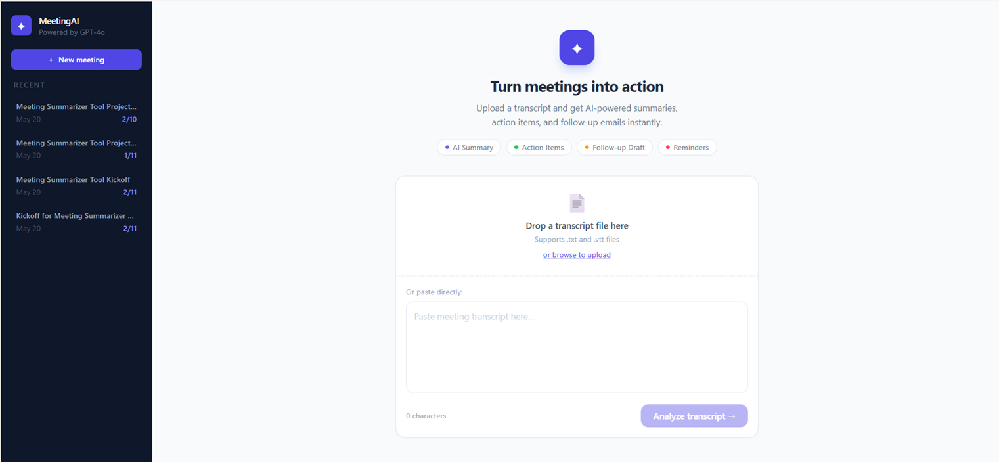
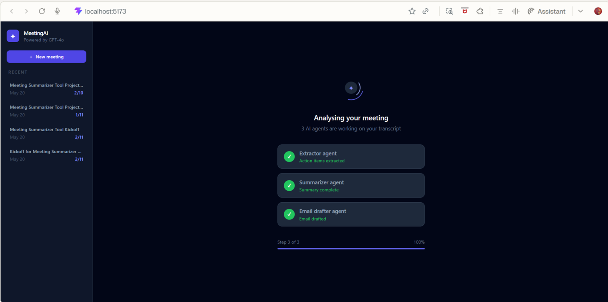
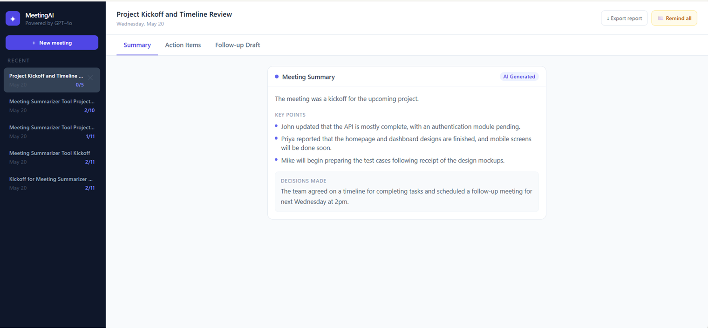
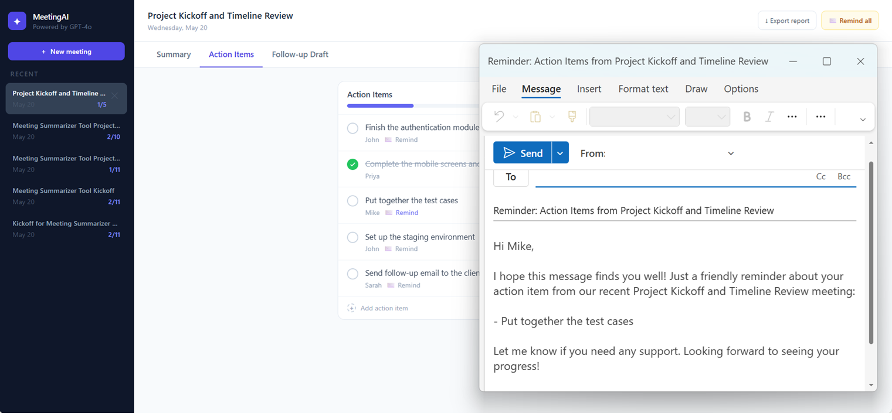
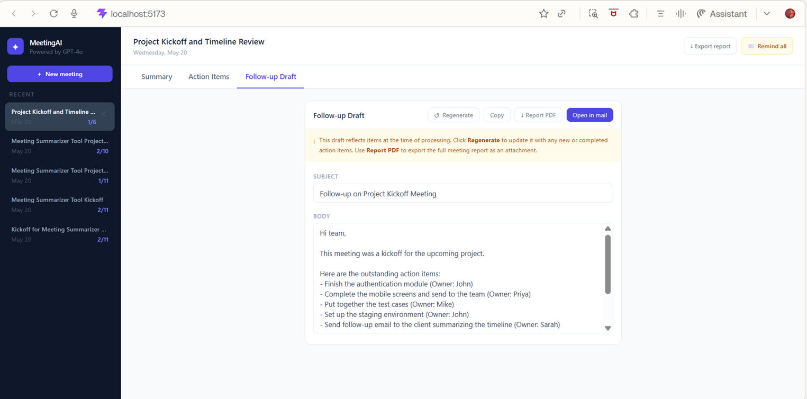
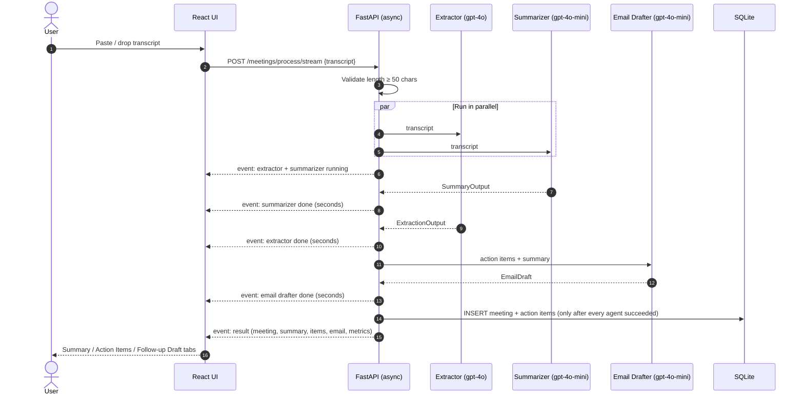
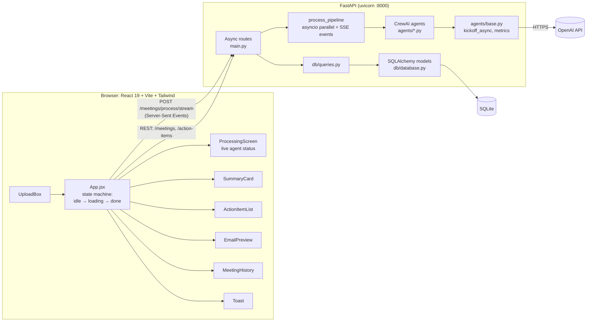

# MeetingAI: Multi-Agent Meeting Summarizer

[](https://github.com/Ruturaj2472/Meeting-Summarizer/actions/workflows/ci.yml)


> **Highlights**
> - **4 specialised CrewAI agents:** Extractor, Summarizer, Email Drafter and Reminder Drafter, each returning a **Pydantic-enforced structured output**
> - **Async and parallel:** the Extractor and Summarizer run at the same time with `asyncio`, and the UI shows **live per-agent progress** streamed with Server-Sent Events
> - **Models chosen per task:** GPT-4o for action-item extraction, where accuracy matters most; GPT-4o-mini for summaries and emails. Every run reports its latency, tokens and cost
> - **Evaluation-driven:** 10 hand-labelled transcripts score extraction precision/recall, summary format and email coverage for each model
> - **Ready to ship:** Docker and Docker Compose, 38 offline pytest tests with mocked LLMs, and GitHub Actions CI

Paste or upload a meeting transcript. MeetingAI runs it through a pipeline of specialised **CrewAI agents** and returns:

- a **structured summary** (overview, key points, decisions),
- an **editable list of action items** with owners,
- a **follow-up email draft** for the whole team,
- **personalised reminder emails** for each person who still has open tasks.

Every meeting is saved, so you can come back later, tick off finished tasks, add new ones and regenerate the follow-up email to match.



---

## Table of Contents

1. [The Problem](#the-problem)
2. [Features](#features)
3. [Screenshots](#screenshots)
4. [How It Works](#how-it-works)
5. [The Agents](#the-agents)
6. [Evaluation](#evaluation)
7. [Architecture](#architecture)
8. [API Reference](#api-reference)
9. [Data Model](#data-model)
10. [Frontend](#frontend)
11. [Tech Stack](#tech-stack)
12. [Project Structure](#project-structure)
13. [Getting Started](#getting-started)
14. [Deploying to AWS EC2](#deploying-to-aws-ec2)
15. [Testing and CI](#testing-and-ci)
16. [Design Decisions](#design-decisions)
17. [License](#license)

---

## The Problem

After a meeting, someone usually has to reread the notes, pull out who agreed to do what, write a recap email and chase people later. MeetingAI automates that work. It splits it into three narrow tasks (**extract**, **summarise**, **draft**) and gives each one to its own LLM agent with a focused role and a strict, schema-validated output.

---

## Features

| Area | What you can do |
|---|---|
| **Input** | Paste text, drag and drop a file, or browse for a `.txt` / `.vtt` transcript. Input under 50 characters is rejected on both the client and the server. |
| **Live progress** | While the agents work, the processing screen shows each agent's real status as the backend reports it, how long each one took, and the total elapsed time. |
| **Auto title** | The extractor agent writes a 5–7 word meeting title, shown with a typewriter animation. |
| **Summary** | One-sentence overview, 2–3 key discussion points and the decisions made. Action items are kept out of the summary on purpose. |
| **Action items** | Each item has a task and an assignee. You can tick items done, edit them inline (Enter saves, Esc cancels) and add new ones by hand. A progress bar shows how many are done. |
| **Follow-up email** | An AI-written team email that lists every pending item with its owner and the completed items separately. The subject and body are editable. You can **Regenerate** it after changing items, **Copy** it, or **Open in mail** (`mailto:`). |
| **Per-person reminder** | Click **Remind** next to an assignee and the reminder agent writes a short email covering only that person's pending tasks. |
| **Remind all** | One email listing every pending task, grouped by assignee. Unassigned items go under "Team". |
| **Export report** | Builds a clean, printable HTML report (summary, decisions, pending and completed items) and opens the print dialog, so you can save it as a PDF. |
| **Meeting history** | Sidebar of past meetings, newest first, each showing its done/total count. Click one to reopen it, or delete it after a confirmation prompt. |
| **Cost visibility** | After processing, the header shows how long the meeting took and roughly what it cost in API calls. |

---

## Screenshots

### 1. Processing: agents working on the transcript

After you click **Analyze transcript**, the progress screen follows the Extractor, Summarizer and Email drafter agents as the backend reports each one finishing.



### 2. Summary tab

An AI-generated title, a one-line overview, key discussion points and the decisions made. The sidebar lists earlier meetings with their done/total count.



### 3. Action items and a personalised reminder

Each action item shows its owner. Tick items off to update the progress bar. Clicking **Remind** next to a name has the reminder agent write an email covering only that person's open tasks, which opens in your mail client.



### 4. Follow-up draft

The team email lists every outstanding item with its owner. The subject and body are editable, and you can **Regenerate**, **Copy**, export a **Report PDF** or **Open in mail**.



---

## How It Works



1. **Extractor** and **Summarizer** both need only the transcript, so they run **at the same time**. Each agent is a CrewAI crew started with `kickoff_async()`, and FastAPI waits on both with `asyncio.wait`, reporting each one as soon as it finishes.
2. **Email Drafter** needs both of their outputs (the items and the summary), so it runs last.
3. The meeting is **saved only after every agent has succeeded**. If any agent fails, nothing is written, and the client gets a clear error: a `502`, or an `error` event on the stream.
4. Each progress event is sent to the browser **as it happens** over Server-Sent Events, so the progress screen reflects real backend state.

After that, everything is driven by the user. Edits, status changes and new items go straight to the database. The follow-up email and reminders are generated on demand from the **current** state of the items.

### Example

[`tests/sample_transcript.txt`](tests/sample_transcript.txt) is a short project kickoff with four attendees (Sarah, John, Priya, Mike), each of whom commits to something with a deadline. It's a good first input. The final `result` payload has this shape (values abbreviated):

```json
{
  "meeting": { "id": 1, "title": "Project Kickoff and Timeline Review", "created_at": "..." },
  "summary": {
    "overview": "The meeting was a kickoff for the upcoming project.",
    "key_points": ["John updated that the API is mostly complete...", "..."],
    "decisions": "The team agreed on a timeline and scheduled a follow-up for next Wednesday at 2pm."
  },
  "action_items": [
    { "id": 1, "text": "Finish the authentication module", "assignee": "John", "status": "pending" },
    { "id": 2, "text": "Complete the mobile screens and send to the team", "assignee": "Priya", "status": "pending" }
  ],
  "email_draft": { "subject": "Follow-up on Project Kickoff Meeting", "body": "Hi team,\n\n..." },
  "metrics": {
    "total_seconds": "...",
    "cost_usd": "...",
    "agents": {
      "extractor": { "model": "gpt-4o", "seconds": "...", "prompt_tokens": "...", "completion_tokens": "...", "cost_usd": "...", "fallback": false },
      "summarizer": { "model": "gpt-4o-mini", "...": "..." },
      "email_drafter": { "model": "gpt-4o-mini", "...": "..." }
    }
  }
}
```

---

## The Agents

All agents live in [`Backend/agents/`](Backend/agents). Each one is a CrewAI `Agent` with a role, goal and backstory, paired with a `Task` that holds the prompt and an **`output_pydantic` schema**. A shared runner in [`agents/base.py`](Backend/agents/base.py) starts the crew asynchronously and records latency, token usage and cost.

| Agent | File | Default model | Input | Output schema | Notable prompt rules |
|---|---|---|---|---|---|
| **Meeting Analyst** (Extractor) | `extractor.py` | `gpt-4o` | Transcript | `ExtractionOutput {title, action_items: [{text, assignee}]}` | 5–7 word title; `assignee` is `null` when no owner is named; rejected ideas are not action items |
| **Meeting Secretary** (Summarizer) | `summarizer.py` | `gpt-4o-mini` | Transcript | `SummaryOutput {overview, key_points[], decisions}` | Under 100 words; **no action items**; plain text only |
| **Executive Assistant** (Email Drafter) | `email_drafter.py` | `gpt-4o-mini` | Action items + summary | `EmailDraft {subject, body}` | Fixed email template; every pending item on its own dashed line; completed items listed separately; under 250 words; no markdown |
| **Executive Assistant** (Reminder Drafter) | `reminder_drafter.py` | `gpt-4o-mini` | One assignee's pending items + meeting title | `EmailDraft {subject, body}` | Addressed by first name; only that person's tasks; friendly, not pushy; under 100 words |

Each agent's model can be changed without touching code: set `EXTRACTOR_MODEL`, `SUMMARIZER_MODEL`, `EMAIL_DRAFTER_MODEL` or `REMINDER_DRAFTER_MODEL`.

### Getting reliable output from an LLM

1. **Schema-enforced output.** Each task declares a Pydantic model ([`models/schemas.py`](Backend/models/schemas.py)) with field descriptions, and CrewAI makes the model return data that fits it. There's no free-text JSON parsing in the code.
2. **Normalisation in the schema.** A validator turns placeholder assignees the model sometimes returns (`"null"`, `"None"`, `""`, `"Unassigned"`) into a real `null`, so the rest of the app never has to handle them.
3. **Safe fallback.** If a reply still fails validation, the agent returns a valid default (`"Untitled Meeting"` with an empty item list, `"Summary unavailable"`, or a template email built from the items) and flags `fallback: true` in the metrics. The API never crashes on a malformed reply.
4. **Clear errors for real failures.** Network errors, timeouts and auth problems are not hidden behind the fallback. They come back as a `502` naming the agent that failed.

The email drafter also has a short-circuit: when there are no action items, it returns a canned email and makes **no LLM call**.

---

## Evaluation

[`evals/`](evals) contains a small labelled benchmark and a script that compares models **for each agent**, so model choices are based on data rather than guesswork.

- **Dataset:** [`evals/dataset.json`](evals/dataset.json) has 10 hand-labelled transcripts: sprint planning, a marketing launch, a customer escalation, hiring, board prep, a design review, an incident postmortem, a client kickoff, a stand-up, and an all-hands meeting with **no** action items. They deliberately include ideas that were rejected, tasks nobody owns, commitments made indirectly ("I can pull the churn numbers"), and people mentioned who don't own the task.
- **Scoring is deterministic (no LLM judge),** in [`evals/scoring.py`](evals/scoring.py):

| Agent | Metrics |
|---|---|
| Extractor | Precision, recall and F1 against the labelled items (an item matches when it contains the labelled keywords), plus assignee accuracy |
| Summarizer | Pass rate on the format rules: under 100 words, 2–3 key points, no markdown, decisions present |
| Email Drafter | Share of items covered and owners named in the email, no markdown, under 250 words. Every model gets the same labelled items as input |
| All | Average latency and cost per call, and the number of fallbacks |

The script also times the full pipeline **sequentially vs. in parallel** on the same transcripts.

```bash
# from the repo root, with OPENAI_API_KEY set (environment or Backend/.env)
pip install -r Backend/requirements.txt
python evals/run_eval.py              # 10 transcripts, gpt-4o vs gpt-4o-mini
python evals/run_eval.py --limit 3    # quicker, cheaper run
```

Results are written to `evals/RESULTS.md` (tables) and `evals/results.json` (raw numbers). A full run makes about 120 API calls.

---

## Architecture



**Development:** Vite serves the UI on `:5173` and proxies `/meetings` and `/action-items` to FastAPI on `:8000`. CORS is also enabled for `http://localhost:5173`.

**Production (Docker):** a multi-stage build compiles the React app and copies `dist/` into the backend's `static/` folder. FastAPI then serves the API and the UI from one origin on port `8000`. With Docker Compose, the SQLite file is kept on a named volume, so meetings survive container restarts and rebuilds.

---

## API Reference

Interactive docs are at `http://localhost:8000/docs` (Swagger UI) once the backend is running.

| Method | Endpoint | Purpose | Uses LLM? |
|---|---|---|---|
| `GET` | `/health` | Liveness check, returns `{"status": "ok"}` | No |
| `POST` | `/meetings/process/stream` | Body `{ "transcript": "..." }`. Runs the pipeline and streams Server-Sent Events: `agent` progress events (`running` / `done` with seconds), then one `result` or `error` event | Yes (3 calls) |
| `POST` | `/meetings/process` | The same pipeline, returning only the final JSON result (useful for scripts) | Yes (3 calls) |
| `GET` | `/meetings` | All meetings, newest first, with parsed summary and action items | No |
| `DELETE` | `/meetings/{meeting_id}` | Deletes a meeting and its action items | No |
| `POST` | `/action-items?meeting_id=&text=&assignee=` | Adds a manual action item | No |
| `PATCH` | `/action-items/{item_id}?text=&status=` | Edits an item's text and/or status (`pending` / `done`) | No |
| `POST` | `/meetings/{meeting_id}/regenerate-email` | Rewrites the follow-up email from the **current** items and the stored summary | Yes |
| `POST` | `/meetings/{meeting_id}/remind/{assignee}` | Personalised reminder for one assignee's pending items (name match ignores case) | Yes |
| `POST` | `/meetings/{meeting_id}/remind-all` | One email of all pending items grouped by assignee, built **without** an LLM | No |

Example stream (timings are illustrative):

```
data: {"type": "agent", "agent": "extractor", "status": "running"}
data: {"type": "agent", "agent": "summarizer", "status": "running"}
data: {"type": "agent", "agent": "summarizer", "status": "done", "seconds": 1.8}
data: {"type": "agent", "agent": "extractor", "status": "done", "seconds": 3.2}
data: {"type": "agent", "agent": "email_drafter", "status": "running"}
data: {"type": "agent", "agent": "email_drafter", "status": "done", "seconds": 2.1}
data: {"type": "result", "data": {"meeting": {...}, "summary": {...}, "action_items": [...], "email_draft": {...}, "metrics": {...}}}
```

Errors use standard HTTP codes: `400` when the transcript is too short, `404` for an unknown meeting or item or when nothing is pending to remind about, and `502` when an LLM agent fails.

---

## Data Model

Two SQLAlchemy tables in [`Backend/db/database.py`](Backend/db/database.py):

```
meetings                          action_items
───────────────────────           ───────────────────────
id          INTEGER PK            id          INTEGER PK
title       STRING                meeting_id  INTEGER  ──► meetings.id
transcript  TEXT                  text        TEXT
summary     TEXT (JSON string)    assignee    STRING (nullable)
created_at  DATETIME              status      STRING  "pending" | "done"
```

- The summary is stored as a **JSON string** and parsed again when read. It's always read and written as a whole and never queried by field, so a separate table wasn't needed.
- Action items have their own table because they change independently (status toggles, edits, manual additions).
- Deleting a meeting removes its action items first, in [`db/queries.py`](Backend/db/queries.py).
- The database URL comes from `DATABASE_URL`, which defaults to a local SQLite file.

---

## Frontend

Built with **React 19**, **Vite** and **Tailwind CSS**, with custom keyframe animations defined in `tailwind.config.js`.

| File | Responsibility |
|---|---|
| `App.jsx` | Owns all state: `appState` (`idle` / `loading` / `done`), the current meeting, items, summary, draft, live agent progress, metrics, history, toasts and the active tab. Handles every API call, the typewriter title, **Remind all** and the **Export report** HTML. |
| `lib/eventStream.js` | Reads the Server-Sent Events stream from a `POST` request (the browser's `EventSource` only supports `GET`), passing on each progress event and returning the final result. |
| `ProcessingScreen.jsx` | Shows each agent's status from the backend's events. The Extractor and Summarizer are marked as running in parallel, finished agents show how long they took, and a progress bar and elapsed-time counter run along the bottom. |
| `UploadBox.jsx` | Drag-and-drop, file picker (`FileReader`) and paste box. Shows a live character count and enforces the 50-character minimum. |
| `SummaryCard.jsx` | Shows the overview, key points and decisions. |
| `ActionItemList.jsx` | Toggle, inline edit, add item, per-assignee **Remind** button with idle / loading / sent states, and a progress bar. |
| `EmailPreview.jsx` | Editable subject and body, plus Regenerate, Copy, Report PDF and Open in mail. |
| `MeetingHistory.jsx` | Sidebar list with done/total counts and hover-to-delete with confirmation. |
| `Toast.jsx` | Success, error and info notifications that close after 3 seconds. |

When an item changes, the update is applied to **both** the open meeting and the matching sidebar entry, so the done/total count stays correct without fetching the list again.

---

## Tech Stack

| Layer | Technology |
|---|---|
| Agent orchestration | **CrewAI** (Agent / Task / Crew, `kickoff_async`, `output_pydantic`) |
| LLMs | **OpenAI GPT-4o** (extraction), **GPT-4o-mini** (summary, emails, reminders), configurable per agent |
| Backend | **FastAPI** (async routes, `StreamingResponse` for Server-Sent Events), **Uvicorn**, **Pydantic v2** |
| Persistence | **SQLAlchemy 2.0** ORM on **SQLite** |
| Frontend | **React 19**, **Vite 8**, **Tailwind CSS 3**, Fetch Streams API |
| Evaluation | Labelled transcript set, deterministic scoring, per-model cost and latency |
| Packaging | Multi-stage **Dockerfile** (Node 22 build → Python 3.11 slim runtime), **Docker Compose** with a persistent volume and health check |
| Testing and CI | **pytest**, FastAPI `TestClient`, mocked CrewAI, in-memory SQLite, **GitHub Actions** |
| Config | `python-dotenv` (`OPENAI_API_KEY`, per-agent `*_MODEL`, `DATABASE_URL`) |

---

## Project Structure

```
Meeting-Summarizer/
├── Backend/
│   ├── main.py                 # Async FastAPI app: parallel pipeline, SSE stream, routes
│   ├── agents/
│   │   ├── base.py             # Async crew runner, model config, token/cost metrics
│   │   ├── extractor.py        # Title + action items (gpt-4o)
│   │   ├── summarizer.py       # Overview / key points / decisions (gpt-4o-mini)
│   │   ├── email_drafter.py    # Team follow-up email (gpt-4o-mini)
│   │   └── reminder_drafter.py # Per-assignee reminder (gpt-4o-mini)
│   ├── db/
│   │   ├── database.py         # Engine, session, ORM models, init_db
│   │   └── queries.py          # CRUD helpers
│   ├── models/
│   │   └── schemas.py          # API schemas + structured-output schemas for agents
│   ├── requirements.txt        # Runtime dependencies
│   ├── requirements-dev.txt    # + pytest, httpx
│   └── .env.example
├── frontend/
│   ├── src/
│   │   ├── App.jsx
│   │   ├── lib/eventStream.js  # SSE-over-POST reader
│   │   ├── components/         # UploadBox, ProcessingScreen, SummaryCard, ActionItemList,
│   │   │                       # EmailPreview, MeetingHistory, Toast
│   │   └── main.jsx, index.css, App.css
│   ├── vite.config.js          # Dev proxy → :8000
│   └── tailwind.config.js      # Theme + custom animations
├── evals/
│   ├── dataset.json            # 10 hand-labelled transcripts
│   ├── scoring.py              # Deterministic metrics
│   └── run_eval.py             # Model comparison + latency benchmark
├── tests/
│   ├── conftest.py             # Paths, env, fake-CrewAI fixture
│   ├── test_agents.py          # Structured outputs, fallbacks, prompts, cost, model config
│   ├── test_api.py             # Endpoints, parallelism, streaming, failure handling
│   ├── test_scoring.py         # Evaluation metrics + dataset sanity checks
│   └── sample_transcript.txt   # Example input
├── .github/workflows/ci.yml    # Tests, frontend build, Docker build
├── docs/                       # Screenshots
├── Dockerfile                  # Multi-stage build
├── docker-compose.yml          # One-command run with persistent DB volume
├── .dockerignore
└── LICENSE
```

---

## Getting Started

### Prerequisites

- Python 3.11 (3.10–3.13 work)
- Node.js 22+
- An OpenAI API key

### 1. Clone

```bash
git clone https://github.com/Ruturaj2472/Meeting-Summarizer.git
cd Meeting-Summarizer
```

### 2. Backend

```bash
cd Backend
python -m venv venv
# Windows: venv\Scripts\activate    macOS/Linux: source venv/bin/activate
pip install -r requirements.txt

cp .env.example .env          # then put your key in OPENAI_API_KEY
uvicorn main:app --reload --port 8000
```

The SQLite database (`meeting_summarizer.db`) is created automatically the first time the server starts.

### 3. Frontend (in a second terminal)

```bash
cd frontend
npm install
npm run dev
```

Open **http://localhost:5173**, paste the contents of `tests/sample_transcript.txt` and click **Analyze transcript**.

### Configuration

| Variable | Required | Default | Purpose |
|---|---|---|---|
| `OPENAI_API_KEY` | Yes | — | OpenAI API key |
| `EXTRACTOR_MODEL` | No | `gpt-4o` | Model for the extractor agent |
| `SUMMARIZER_MODEL` | No | `gpt-4o-mini` | Model for the summarizer agent |
| `EMAIL_DRAFTER_MODEL` | No | `gpt-4o-mini` | Model for the follow-up email agent |
| `REMINDER_DRAFTER_MODEL` | No | `gpt-4o-mini` | Model for the reminder agent |
| `DATABASE_URL` | No | `sqlite:///./meeting_summarizer.db` | Any SQLAlchemy database URL |

### Run with Docker Compose (recommended)

```bash
cp Backend/.env.example Backend/.env   # add your OPENAI_API_KEY
docker compose up --build
```

Open **http://localhost:8000**. FastAPI serves both the React build and the API. Meetings are stored on the `meeting-data` volume, so they are kept across restarts. `docker compose down -v` deletes them.

### Run with plain Docker

```bash
docker build -t meeting-summarizer .
docker run -p 8000:8000 -e OPENAI_API_KEY=sk-... meeting-summarizer
```

---

## Deploying to AWS EC2

The app ships as one container, so any small Linux instance (for example a `t3.small` running Amazon Linux 2023) can run it.

1. **Launch an instance** and open inbound port `8000` (or `80`) in its security group, along with `22` for SSH.
2. **Install Docker and the Compose plugin:**
   ```bash
   sudo dnf install -y docker git
   sudo systemctl enable --now docker
   sudo usermod -aG docker $USER && newgrp docker
   sudo mkdir -p /usr/local/lib/docker/cli-plugins
   sudo curl -SL https://github.com/docker/compose/releases/latest/download/docker-compose-linux-x86_64 \
     -o /usr/local/lib/docker/cli-plugins/docker-compose
   sudo chmod +x /usr/local/lib/docker/cli-plugins/docker-compose
   ```
3. **Clone, configure and start:**
   ```bash
   git clone https://github.com/Ruturaj2472/Meeting-Summarizer.git && cd Meeting-Summarizer
   cp Backend/.env.example Backend/.env && nano Backend/.env   # set OPENAI_API_KEY
   docker compose up -d --build
   ```
4. Open `http://<instance-public-ip>:8000`. Compose restarts the container automatically and keeps the database on its volume. Check `docker compose ps` for the health status.

To update, run `git pull && docker compose up -d --build`. To serve it on port 80 with HTTPS, put Nginx or Caddy in front of port 8000.

---

## Testing and CI

The test suite runs **offline and for free**. CrewAI's `Crew` is replaced with a mock whose `kickoff_async()` returns canned structured output, and the API runs against an in-memory SQLite database, so no OpenAI key is used.

```bash
pip install -r Backend/requirements-dev.txt
pytest tests -v
```

| File | What it covers |
|---|---|
| `tests/test_agents.py` | Each agent declares the right `output_pydantic` schema and returns its data, falls back safely when validation fails, records token usage, and supports model overrides. Blank assignees become `null`. The email drafter makes no LLM call when there are no items. Cost is computed correctly, and per-agent models can be set with environment variables. |
| `tests/test_api.py` | Health check and transcript validation. `/meetings/process` saves the meeting and returns per-agent metrics. **The extractor and summarizer really run in parallel** (the test only passes if both are running at the same time). **The stream emits progress events in the right order and then the result.** A failing agent returns `502` or an `error` event, and nothing is saved. Editing and adding items, remind-all grouping, case-insensitive reminders, regenerating from current state, and deleting. |
| `tests/test_scoring.py` | Evaluation metrics (matching, precision/recall, assignee accuracy, summary and email checks) and a sanity check that every labelled keyword and assignee actually appears in its transcript. |

**CI:** [`.github/workflows/ci.yml`](.github/workflows/ci.yml) runs three jobs on every push and pull request: the backend tests, a frontend production build, and a Docker image build.

---

## Design Decisions

**Why several small agents instead of one big prompt?**
Each agent does one job with its own output schema. That keeps prompts short, makes the output easier to check, lets independent steps run in parallel, and lets each step use the right model. Extraction is the step where accuracy matters most (missing a commitment is the worst failure), so it uses `gpt-4o`. Summaries and emails are easier writing tasks, so they use the cheaper, faster `gpt-4o-mini`. `evals/run_eval.py` measures this trade-off rather than assuming it.

**Why run the extractor and summarizer in parallel?**
Both need only the transcript, so neither has to wait for the other. Running them together means the wait before the email drafter starts is set by whichever of the two is slower, not by both added together. The email drafter needs both outputs, so it stays last.

**Why Server-Sent Events instead of WebSockets or polling?**
Progress only flows from the server to the browser, so one streaming HTTP response is enough. There's no extra protocol, no job table and no polling loop. A plain `POST /meetings/process` still exists for scripts and tests.

**Why save the meeting only after every agent succeeds?**
That way a failed run leaves nothing behind: no meeting without a summary, and no items without an email. The user can simply try again.

**Why structured outputs instead of parsing JSON from text?**
A schema makes the model's output part of the contract: missing or mistyped fields become validation errors instead of bugs further down. The Pydantic models also clean values up in one place (for example, `"null"` becomes `None`).

**Why is "Remind all" built without an LLM?**
It's a simple group-by-assignee list, and code can produce it exactly. That makes it instant, free and always accurate. The LLM is used only where wording matters (the personalised one-person reminder).

**Why deterministic evaluation metrics instead of an LLM judge?**
Keyword matching and rule checks give the same answer every time, cost nothing and are easy to explain. Every score can be traced back to a specific label. An LLM judge would add cost, run-to-run variation and its own bias.

**Why SQLite?**
No setup and a single file, which suits a single-user app. Because all access goes through SQLAlchemy and `DATABASE_URL`, moving to PostgreSQL is a configuration change.

**Why `mailto:` instead of sending email?**
The user always reviews and sends the email from their own mail client. The app never needs SMTP credentials and never sends anything automatically.

**Why mock CrewAI in tests instead of calling the model?**
LLM output varies from run to run and costs money. Mocking `Crew.kickoff_async()` makes the tests deterministic and lets them simulate failures and invalid output, which is the only reliable way to test the fallback and error paths.

---

## License

[MIT](LICENSE) © 2026 Ruturaj
