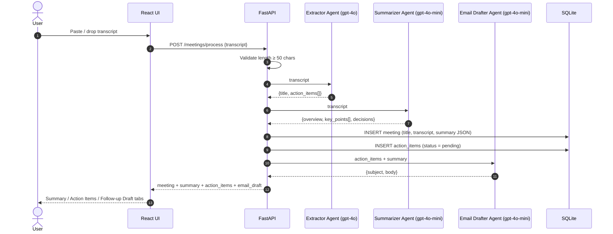
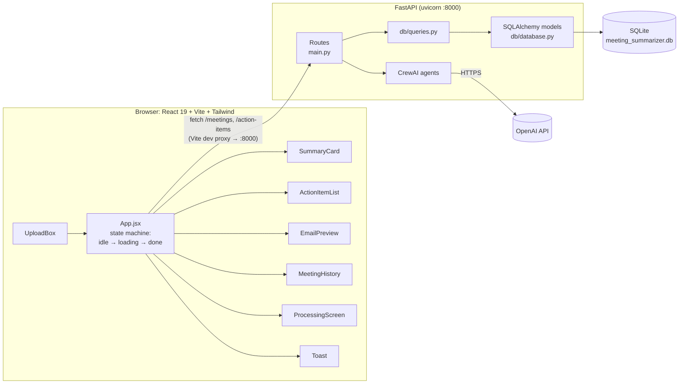

# MeetingAI: Multi-Agent Meeting Summarizer


> **Highlights**
> - **4 specialised CrewAI agents:** Extractor, Summarizer, Email Drafter and Reminder Drafter, each with one job and a strict JSON output format
> - **Models chosen per task:** GPT-4o for action-item extraction, where accuracy matters most; GPT-4o-mini for summaries and emails
> - **Reliable LLM output:** JSON is parsed even with extra text around it, with a safe fallback, so a malformed reply never crashes the API
> - **Full stack:** FastAPI + SQLAlchemy backend, React 19 + Tailwind frontend, with editing, reminders and report export
> - **Ready to ship:** multi-stage Docker build, Docker Compose with a persistent database volume, and 23 offline pytest tests with mocked LLMs

Paste or upload a meeting transcript. MeetingAI runs it through a pipeline of specialised **CrewAI agents** and returns:

- a **structured summary** (overview, key points, decisions),
- an **editable list of action items** with owners,
- a **follow-up email draft** for the whole team,
- **personalised reminder emails** for each person who still has open tasks.

Every meeting is saved, so you can come back later, tick off finished tasks, add new ones and regenerate the follow-up email to match.


---

## Table of Contents

1. [The Problem](#the-problem)
2. [Features](#features)
3. [Screenshots](#screenshots)
4. [How It Works](#how-it-works)
5. [The Agents](#the-agents)
6. [Architecture](#architecture)
7. [API Reference](#api-reference)
8. [Data Model](#data-model)
9. [Frontend](#frontend)
10. [Tech Stack](#tech-stack)
11. [Project Structure](#project-structure)
12. [Getting Started](#getting-started)
13. [Testing](#testing)
14. [Design Decisions](#design-decisions)
15. [License](#license)

---

## The Problem

After a meeting, someone usually has to reread the notes, pull out who agreed to do what, write a recap email and chase people later. MeetingAI automates that work. It splits it into three narrow tasks (**extract**, **summarise**, **draft**) and gives each one to its own LLM agent with a focused role and a strict output format.

---

## Features

| Area | What you can do |
|---|---|
| **Input** | Paste text, drag and drop a file, or browse for a `.txt` / `.vtt` transcript. Input under 50 characters is rejected on both the client and the server. |
| **Auto title** | The extractor agent writes a 5–7 word meeting title, shown with a typewriter animation. |
| **Summary** | One-sentence overview, 2–3 key discussion points and the decisions made. Action items are kept out of the summary on purpose. |
| **Action items** | Each item has a task and an assignee. You can tick items done, edit them inline (Enter saves, Esc cancels) and add new ones by hand. A progress bar shows how many are done. |
| **Follow-up email** | An AI-written team email that lists every pending item with its owner and the completed items separately. The subject and body are editable. You can **Regenerate** it after changing items, **Copy** it, or **Open in mail** (`mailto:`). |
| **Per-person reminder** | Click **Remind** next to an assignee and the reminder agent writes a short email covering only that person's pending tasks. |
| **Remind all** | One email listing every pending task, grouped by assignee. Unassigned items go under "Team". |
| **Export report** | Builds a clean, printable HTML report (summary, decisions, pending and completed items) and opens the print dialog, so you can save it as a PDF. |
| **Meeting history** | Sidebar of past meetings, newest first, each showing its done/total count. Click one to reopen it, or delete it after a confirmation prompt. |
| **UX polish** | A processing screen that walks through each agent step, toast notifications, and empty states for older meetings that have no summary or draft. |

---

## Screenshots

### 1. Processing: three agents working on the transcript

After you click **Analyze transcript**, a progress screen walks through the Extractor, Summarizer and Email drafter agents.


### 2. Summary tab

An AI-generated title, a one-line overview, key discussion points and the decisions made. The sidebar lists earlier meetings with their done/total count.


### 3. Action items and a personalised reminder

Each action item shows its owner. Tick items off to update the progress bar. Clicking **Remind** next to a name has the reminder agent write an email covering only that person's open tasks, which opens in your mail client.


### 4. Follow-up draft

The team email lists every outstanding item with its owner. The subject and body are editable, and you can **Regenerate**, **Copy**, export a **Report PDF** or **Open in mail**.


---

## How It Works



The pipeline runs in order. Each agent gets only the input it needs:

1. **Extractor**: reads the transcript and returns a title plus a list of action items.
2. **Summarizer**: reads the same transcript and returns a summary that leaves out action items.
3. **Email Drafter**: gets the extracted items and the summary, not the raw transcript, and writes the follow-up email.

After that, everything is driven by the user. Edits, status changes and new items go straight to the database. The follow-up email and reminders are generated on demand from the **current** state of the items.

### Example

[`tests/sample_transcript.txt`](tests/sample_transcript.txt) is a short project kickoff with four attendees (Sarah, John, Priya, Mike), each of whom commits to something with a deadline. It's a good first input. The response has this shape (values abbreviated):

```json
{
  "meeting": { "id": 1, "title": "Project Kickoff and Timeline Planning", "created_at": "..." },
  "summary": {
    "overview": "Kickoff meeting to review progress on backend, design and QA...",
    "key_points": ["Backend API nearly complete...", "..."],
    "decisions": "The team will reconvene next Wednesday at 2pm..."
  },
  "action_items": [
    { "id": 1, "text": "Finish the authentication module by Wednesday", "assignee": "John", "status": "pending" },
    { "id": 2, "text": "Send mobile screen designs by end of day Thursday", "assignee": "Priya", "status": "pending" }
  ],
  "email_draft": { "subject": "...", "body": "Hi team,\n\n..." }
}
```

---

## The Agents

All agents live in [`Backend/agents/`](Backend/agents). Each one is a CrewAI `Agent` with a role, goal and backstory, paired with a `Task` that holds the prompt and the required JSON format, and run by its own `Crew`.

| Agent | File | Model | Input | Output | Notable prompt rules |
|---|---|---|---|---|---|
| **Meeting Analyst** (Extractor) | `extractor.py` | `gpt-4o` | Transcript | `{title, action_items: [{text, assignee}]}` | 5–7 word title; `assignee` is `null` when no owner is named |
| **Meeting Secretary** (Summarizer) | `summarizer.py` | `gpt-4o-mini` | Transcript | `{overview, key_points[], decisions}` | Under 100 words; **no action items**; plain text only |
| **Executive Assistant** (Email Drafter) | `email_drafter.py` | `gpt-4o-mini` | Action items + summary | `{subject, body}` | Fixed email template; every pending item on its own dashed line; completed items listed separately; under 250 words; no markdown |
| **Executive Assistant** (Reminder Drafter) | `reminder_drafter.py` | `gpt-4o-mini` | One assignee's pending items + meeting title | `{subject, body}` | Addressed by first name; only that person's tasks; friendly, not pushy; under 100 words |

### Getting reliable JSON from an LLM

Each agent uses the same three-layer approach:

1. **Prompt contract**: the task description includes the exact JSON shape and says *"respond with ONLY a valid JSON object… no text outside the JSON."*
2. **Tolerant parsing**: a regex (`\{.*\}` with `re.DOTALL`) pulls out the first-to-last brace span, so stray text around the JSON doesn't break `json.loads`.
3. **Safe fallback**: if parsing still fails, the function returns a valid default (`"Untitled Meeting"` with an empty item list, `"Summary unavailable"`, or a template email built from the items). The API never crashes because of a malformed LLM reply.

The email drafter also has a short-circuit: when there are no action items, it returns a canned email and makes **no LLM call**.

---

## Architecture



**Development:** Vite serves the UI on `:5173` and proxies `/meetings` and `/action-items` to FastAPI on `:8000`. CORS is also enabled for `http://localhost:5173`.

**Production (Docker):** a multi-stage build compiles the React app and copies `dist/` into the backend's `static/` folder. FastAPI then serves the API and the UI from one origin on port `8000`. With Docker Compose, the SQLite file is kept on a named volume, so meetings survive container restarts and rebuilds.

---

## API Reference

Interactive docs are at `http://localhost:8000/docs` (Swagger UI) once the backend is running.

| Method | Endpoint | Purpose | Uses LLM? |
|---|---|---|---|
| `GET` | `/health` | Liveness check, returns `{"status": "ok"}` | No |
| `POST` | `/meetings/process` | Body `{ "transcript": "..." }`. Runs extractor → summarizer → drafter, saves the results and returns everything | Yes (3 calls) |
| `GET` | `/meetings` | All meetings, newest first, with parsed summary and action items | No |
| `DELETE` | `/meetings/{meeting_id}` | Deletes a meeting and its action items | No |
| `POST` | `/action-items?meeting_id=&text=&assignee=` | Adds a manual action item | No |
| `PATCH` | `/action-items/{item_id}?text=&status=` | Edits an item's text and/or status (`pending` / `done`) | No |
| `POST` | `/meetings/{meeting_id}/regenerate-email` | Rewrites the follow-up email from the **current** items and the stored summary | Yes |
| `POST` | `/meetings/{meeting_id}/remind/{assignee}` | Personalised reminder for one assignee's pending items (name match ignores case) | Yes |
| `POST` | `/meetings/{meeting_id}/remind-all` | One email of all pending items grouped by assignee, built **without** an LLM | No |

Errors use standard HTTP codes: `400` when the transcript is too short, and `404` for an unknown meeting or item, or when nothing is pending to remind about.

---

## Data Model

Two SQLAlchemy tables in [`Backend/db/database.py`](Backend/db/database.py):

```
meetings                          action_items
───────────────────────           ───────────────────────
id          INTEGER PK            id          INTEGER PK
title       STRING                meeting_id  INTEGER  ──► meetings.id
transcript  TEXT                  text        TEXT
summary     TEXT (JSON string)    assignee    STRING (nullable)
created_at  DATETIME              status      STRING  "pending" | "done"
```

- The summary is stored as a **JSON string** and parsed again when read. It's always read and written as a whole and never queried by field, so a separate table wasn't needed.
- Action items have their own table because they change independently (status toggles, edits, manual additions).
- Deleting a meeting removes its action items first, in [`db/queries.py`](Backend/db/queries.py).
- Pydantic schemas for requests and responses are in [`Backend/models/schemas.py`](Backend/models/schemas.py).

---

## Frontend

Built with **React 19**, **Vite** and **Tailwind CSS**, with custom keyframe animations defined in `tailwind.config.js`.

| Component | Responsibility |
|---|---|
| `App.jsx` | Owns all state: `appState` (`idle` / `loading` / `done`), the current meeting, items, summary, draft, history, toasts and the active tab. Handles every API call, the typewriter title, **Remind all** and the **Export report** HTML. |
| `UploadBox.jsx` | Drag-and-drop, file picker (`FileReader`) and paste box. Shows a live character count and enforces the 50-character minimum. |
| `ProcessingScreen.jsx` | Three-step agent progress view (Extractor → Summarizer → Email drafter) with a progress bar. |
| `SummaryCard.jsx` | Shows the overview, key points and decisions. |
| `ActionItemList.jsx` | Toggle, inline edit, add item, per-assignee **Remind** button with idle / loading / sent states, and a progress bar. |
| `EmailPreview.jsx` | Editable subject and body, plus Regenerate, Copy, Report PDF and Open in mail. |
| `MeetingHistory.jsx` | Sidebar list with done/total counts and hover-to-delete with confirmation. |
| `Toast.jsx` | Success, error and info notifications that close after 3 seconds. |

When an item changes, the update is applied to **both** the open meeting and the matching sidebar entry, so the done/total count stays correct without fetching the list again.

---

## Tech Stack

| Layer | Technology |
|---|---|
| Agent orchestration | **CrewAI** (Agent / Task / Crew) |
| LLMs | **OpenAI GPT-4o** (extraction), **GPT-4o-mini** (summary, emails, reminders) |
| Backend | **FastAPI**, **Uvicorn**, **Pydantic v2** |
| Persistence | **SQLAlchemy 2.0** ORM on **SQLite** |
| Frontend | **React 19**, **Vite 8**, **Tailwind CSS 3**, ESLint |
| Packaging | Multi-stage **Dockerfile** (Node 22 build → Python 3.11 slim runtime), **Docker Compose** with a persistent volume and health check |
| Testing | **pytest**, FastAPI `TestClient`, mocked CrewAI, in-memory SQLite |
| Config | `python-dotenv` (`OPENAI_API_KEY`, optional `DATABASE_URL`) |

---

## Project Structure

```
Meeting-Summarizer/
├── Backend/
│   ├── main.py                 # FastAPI app: routes, CORS, static file serving
│   ├── agents/
│   │   ├── extractor.py        # Title + action items (gpt-4o)
│   │   ├── summarizer.py       # Overview / key points / decisions (gpt-4o-mini)
│   │   ├── email_drafter.py    # Team follow-up email (gpt-4o-mini)
│   │   └── reminder_drafter.py # Per-assignee reminder (gpt-4o-mini)
│   ├── db/
│   │   ├── database.py         # Engine, session, ORM models, init_db
│   │   └── queries.py          # CRUD helpers
│   ├── models/
│   │   └── schemas.py          # Pydantic schemas
│   ├── requirements.txt
│   └── .env.example
├── frontend/
│   ├── src/
│   │   ├── App.jsx
│   │   ├── components/         # UploadBox, SummaryCard, ActionItemList, EmailPreview,
│   │   │                       # MeetingHistory, ProcessingScreen, Toast
│   │   └── main.jsx, index.css, App.css
│   ├── vite.config.js          # Dev proxy → :8000
│   └── tailwind.config.js      # Theme + custom animations
├── tests/
│   ├── conftest.py             # Puts Backend/ on the path, fake-CrewAI fixture
│   ├── test_agents.py          # Agent prompt, parsing and fallback tests
│   ├── test_api.py             # Endpoint tests against in-memory SQLite
│   └── sample_transcript.txt   # Example input
├── docs/                       # Screenshots
├── Dockerfile                  # Multi-stage build
├── docker-compose.yml          # One-command run with persistent DB volume
├── .dockerignore
└── LICENSE
```

---

## Getting Started

### Prerequisites

- Python 3.11
- Node.js 22+
- An OpenAI API key

### 1. Clone

```bash
git clone https://github.com/Ruturaj2472/Meeting-Summarizer.git
cd Meeting-Summarizer
```

### 2. Backend

```bash
cd Backend
python -m venv venv
# Windows: venv\Scripts\activate    macOS/Linux: source venv/bin/activate
pip install -r requirements.txt

cp .env.example .env          # then put your key in OPENAI_API_KEY
uvicorn main:app --reload --port 8000
```

The SQLite database (`meeting_summarizer.db`) is created automatically the first time the server starts. To use a different location or database, set `DATABASE_URL` (any SQLAlchemy URL).

### 3. Frontend (in a second terminal)

```bash
cd frontend
npm install
npm run dev
```

Open **http://localhost:5173**, paste the contents of `tests/sample_transcript.txt` and click **Analyze transcript**.

### Run with Docker Compose (recommended)

```bash
cp Backend/.env.example Backend/.env   # add your OPENAI_API_KEY
docker compose up --build
```

Open **http://localhost:8000**. FastAPI serves both the React build and the API. Meetings are stored on the `meeting-data` volume, so they are kept across restarts. `docker compose down -v` deletes them.

### Run with plain Docker

```bash
docker build -t meeting-summarizer .
docker run -p 8000:8000 -e OPENAI_API_KEY=sk-... meeting-summarizer
```

---

## Testing

The test suite runs **offline and for free**. CrewAI's `Agent`, `Task` and `Crew` are replaced with mocks that return canned LLM output, and the API runs against an in-memory SQLite database, so no OpenAI key is used.

```bash
pip install -r Backend/requirements.txt
pytest tests -v
```

| File | What it covers |
|---|---|
| `tests/test_agents.py` | Each agent parses JSON even with extra text around it, and falls back to safe defaults on missing or malformed JSON. The email drafter makes no LLM call when there are no items and splits pending and completed items in its prompt. The reminder drafter's prompt covers only that person's tasks. |
| `tests/test_api.py` | Health check. The 50-character transcript check. `/meetings/process` saves the meeting and returns everything. Editing and adding items, and `404`s for unknown IDs. **Remind all** grouping (unassigned items go under "Team", done items are left out). Case-insensitive per-person reminders. Regenerating the email uses the **current** item status. Deleting a meeting. |

---

## Design Decisions

**Why several small agents instead of one big prompt?**
Each agent does one job with its own output format. That keeps prompts short, makes the output easier to check, and lets each step use the right model. Extraction is the step where accuracy matters most (missing a commitment is the worst failure), so it uses `gpt-4o`. Summaries and emails are easier writing tasks, so they use the cheaper, faster `gpt-4o-mini`.

**Why is the summarizer told to leave out action items?**
To avoid duplication. Action items are shown and tracked in their own tab, so the summary covers only *discussion and decisions*.

**Why does the email drafter get extracted items instead of the transcript?**
It keeps the email consistent with what the user sees and has edited. Because regeneration reads from the database, an email regenerated after the user ticks items off or adds new ones reflects the current state, not the original transcript.

**Why is "Remind all" built without an LLM?**
It's a simple group-by-assignee list, and code can produce it exactly. That makes it instant, free and always accurate. The LLM is used only where wording matters (the personalised one-person reminder).

**Why store the summary as a JSON string?**
It's always read and written as a whole and never filtered by field, so a separate table would add joins with no benefit.

**Why SQLite?**
No setup and a single file, which suits a single-user app. Because all access goes through SQLAlchemy, moving to PostgreSQL mostly means changing `DATABASE_URL`.

**Why `mailto:` instead of sending email?**
The user always reviews and sends the email from their own mail client. The app never needs SMTP credentials and never sends anything automatically.

**Why mock CrewAI in tests instead of calling the model?**
LLM output varies from run to run and costs money. Mocking `Crew.kickoff()` makes the tests deterministic. It also makes it easy to feed in malformed replies, which is the only way to reliably test the JSON fallback paths.

---

## License

[MIT](LICENSE) © 2026 Ruturaj
